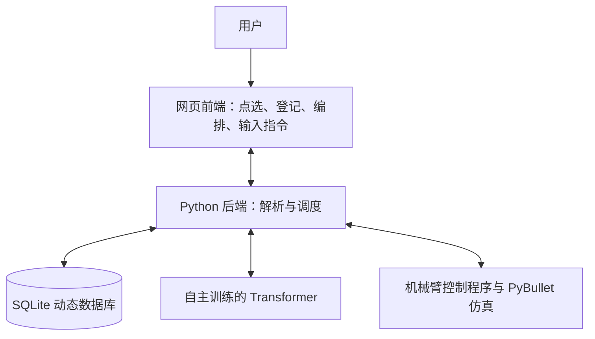
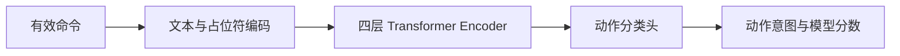

# 面向非编程用户的轻量化机械臂自然语言编排系统

> 通过网页点选、可视化编排和自主训练的小模型，让没有编程基础的用户也能定义和调用机械臂任务。

## 目录

- [1. 设计目的](#1-设计目的)
- [2. 项目结构](#2-项目结构)
- [3. 技术亮点](#3-技术亮点)

---

## 1. 设计目的

本项目面向没有编程基础的机械臂使用者，希望将原本需要编写程序的任务，转化为直观的网页操作。用户只需点选位置、填写名称、组合动作，就可以建立自己的抓取任务，并通过自然语言调用。

传统使用方式中，调整物体位置、增加抓取目标或改变动作顺序，往往需要修改控制程序。项目希望将这些日常调整交给使用者自己完成，让编程人员负责提供基础动作能力，让用户通过界面配置具体业务任务，减少重复开发和维护成本。

例如，用户可以将一个方块命名为“零件A”，将一个位置命名为“装配区”，再编排“抓取零件A → 放到装配区”的任务，保存为“收拾零件”。之后输入“帮我执行收拾零件”，即可调用保存的任务。

项目采用自主训练的小型 Transformer 理解动作意图，通过动态数据库保存目标和任务。这样既能适应多种自然语言表达，也能让用户持续增加、修改或删除目标，而不必反复训练模型。

系统默认使用 CPU 推理，以树莓派等开发板作为后续部署方向，目标是降低对独立显卡和高性能计算设备的依赖，减少算力侧硬件预算。

项目围绕三个目标展开：

- **操作简单**：通过点选示教、名称登记和可视化编排完成任务配置。
- **成本可控**：使用本地小模型识别动作，避免把独立显卡作为运行前提。
- **持续可扩展**：通过维护数据库增加目标和组合任务，减少重新训练的需求。
- **使用自然语言输入**：便于用户维护和使用。

---

## 2. 项目结构

### 2.1 整体架构

系统由机械臂仿真、网页前端和 Python 后端组成。用户通过网页登记数据和下达指令，后端结合数据库与意图模型确定任务，再交给机械臂控制程序执行，并将画面和结果反馈到网页。



主要代码按职责划分，便于分别维护界面、语言模型和机械臂控制：

```text
robot_grasping/
├── frontend/        # 网页工作台与交互
├── backend/         # 接口、数据库、语言解析与执行调度
├── llm/             # 模型、训练数据、权重和实验记录
├── robot/           # 场景、机械臂控制和基础动作
├── launch/web.py    # 统一启动入口
└── tests/           # 自动化验证
```

### 2.2 机械臂模型、仿真与控制程序

项目使用 **PyBullet 开源物理仿真环境**和其中的 **Franka Panda URDF 模型**，构建七自由度机械臂、双指夹爪及红蓝绿方块组成的演示场景。网页展示仿真相机画面，用户可以直接点击画面采集位置。

机械臂 URDF 和网格随工程保存在 `robot/models/franka_panda/`，保留上游 Apache License 2.0 许可证；场景程序直接从仓库加载，模型和控制代码均纳入开源范围。

机械臂控制程序集中在 `robot/` 中，负责逆运动学求解、机械臂移动、夹爪开合以及抓取和放置动作。后端根据用户登记的坐标调用这些程序，再依据实际接触和物体运动判断执行结果。

相关代码：[场景建立](robot/demo.py)、[抓取与控制](robot/grasp.py)、[移动和放置](robot/skills.py)。

### 2.3 网页前端

前端以网页工作台呈现，用户可以查看机械臂画面、点击采集坐标、登记物体和放置点，并按顺序组合任务步骤。编排完成后，可以先测试坐标，再通过自然语言调用任务。

界面同时显示识别出的有效命令、匹配目标和实际执行反馈，让用户能够检查自己的配置，并根据抓取或放置结果进行调整。前端代码集中在 `frontend/` 中。

### 2.4 Python 后端

后端负责连接网页、数据库、意图模型和机械臂控制程序：保存用户配置，解析自然语言，将模型识别出的动作与数据库中的目标参数组合，再调度执行。接口与数据管理位于 `backend/`，模型、训练数据和权重位于 `llm/`。

---

## 3. 技术亮点

### 3.1 数据库与模型解耦，新增和删除目标无需重训练

项目将动作理解与业务数据分开：**模型识别动作，数据库确定目标、坐标和任务步骤。**

#### 动态数据库保存什么

系统采用 SQLite 保存用户明确登记的内容。物体库首次建立时为空，场景中的方块不会自动变成已经命名的目标，用户需要自己点选位置并保存名称。登记结果在重启后保留。

| 数据表 | 保存内容 | 作用 |
|---|---|---|
| `objects` | 物体 ID、名称、别名、坐标和关联技能 | 将用户的叫法绑定到具体操作目标 |
| `placement_points` | 放置点 ID、名称、别名和位置 | 明确物体应该放在哪里 |
| `tasks` | 任务 ID、名称、别名和有序动作步骤 | 保存用户自己编排的程序 |

一个物体可以关联多个已实现技能。任务通过目标 ID 引用物体和放置点，使名称、位置和动作步骤能够独立维护。例如，用户可以修改“装配区”的位置，继续通过同一个名称调用相关任务。

#### 名称如何进入模型

用户输入指令后，系统按照已登记的完整名称或别名匹配目标。匹配到物体后，将名称替换为 `<OBJ>`；匹配到任务后，替换为 `<TASK>`。这两个占位符都是模型已有的特殊 token。

```text
抓取零件A      → 抓取<OBJ> → GRASP
抓取客户零件甲 → 抓取<OBJ> → GRASP
执行收拾零件   → 执行<TASK> → RUN_TASK
```

数据库还支持用户为同一目标补充不同叫法，例如：

| 登记名称 | 别名 |
|---|---|
| 零件A | 红色方块、小红块 |
| 装配区 | 归位点 |
| 收拾零件 | 整理零件 |

这些名称关系由用户登记，模型不需要记住具体物体名称，也不会替用户猜测未登记名称的身份。

#### 为什么可以免重训练扩展

虽然用户登记的名称发生变化，模型接收的仍是相同形式的动作表达。因此，新增、修改或删除物体、别名、放置点，以及基于已有技能组合的新任务，都只需要更新数据库，**不改变模型词表、分类维度和权重**。

例如，用户增加一个新的抓取目标时，只需采集位置、填写名称并保存。用户增加“收拾零件”任务时，只需将已有抓取、移动和放置技能组合成步骤。两种情况都复用原来的动作识别模型。

| 用户调整 | 变化发生在哪里 | 是否重新训练 |
|---|---|---|
| 新增或删除物体、别名 | 数据库登记信息 | 否 |
| 修改物体或放置点坐标 | 数据库位置数据 | 否 |
| 新建或修改组合任务 | 数据库任务步骤 | 否 |

删除被任务引用的目标时，需要先调整对应任务；数据库内容更新后，旧的解析结果需要重新生成，确保执行使用的是当前配置。

这一扩展方式面向新目标和已有技能的组合；新增底层动作能力时，仍需实现相应控制逻辑。

相关代码：[数据库建立与增删改查](backend/store.py)、[名称匹配与占位符替换](backend/instructions.py)。

### 3.2 自主训练的轻量化意图模型

项目使用自主训练的**四层 Transformer Encoder**识别动作意图，将用户的自然语言表达转换为固定动作类别。目标名称、坐标和任务步骤由数据库提供，模型专注于判断用户想执行什么动作。

#### 模型结构与关键参数

| 项目 | 当前设计 |
|---|---|
| Encoder 层数 | 4 层 |
| 隐藏维度 `d_model` | 192 |
| 多头注意力头数 | 4 |
| 前馈网络 | `192 → 768 → 192`，使用 GELU 激活 |
| Dropout | 0.1 |
| 归一化 | Encoder 层采用 Pre-LN，堆叠后另有最终 LayerNorm |
| 位置编码 | 可学习的位置嵌入 |
| Tokenizer | 字符级编码，`<OBJ>`、`<TASK>` 各自作为一个特殊 token |
| 当前词表大小 | 224 个 token |
| 最大序列长度 | 64 个 token，包含 `<CLS>` 和 `<SEP>` |
| 分类方式 | 读取 `<CLS>` 表征，使用 `Linear(192, 7)` 分类头 |
| 参数数量 | 1,836,487，约 184 万 |
| 权重文件 | 当前 checkpoint 约 7.03 MiB |
| 推理设备与线程 | CPU，网页后端默认设置 4 个计算线程 |
| 模型分数门槛 | 0.6，仍需通过意图和执行参数校验 |



#### 模型识别能力

模型固定输出以下七类意图，名称和坐标由数据库提供：

| 模型类别 | 含义 | 自然语言示例 | 执行条件或处理方式 |
| --- | --- | --- | --- |
| `GRASP` | 抓取物体 | “帮我抓取红色方块”“把红色方块拿起来” | 已登记物体名称、抓取坐标和关联技能 |
| `PLACE` | 放置当前持物 | “把蓝色方块放到红色方块上方”“放到红色方块上方” | 已夹持对应物体，并登记明确的放置点；可用于方块堆叠 |
| `MOVE` | 移动夹爪到点位 | “移动到待机点” | “待机点”需在物体库中登记为普通点位，坐标为世界绝对坐标 |
| `STOP` | 停止当前动作或任务 | “停止任务”“停下来” | 无需目标名称；网页停止按钮也可独立使用 |
| `RUN_TASK` | 执行用户保存的组合任务 | “执行叠罗汉”“运行收拾零件” | 对应任务名称或别名已登记，步骤和当前状态通过校验 |
| `CLARIFY` | 要求不明确，需要澄清 | “抓那个” | 缺少明确目标或要求未确认时提示补充，不执行动作 |
| `UNSUPPORTED` | 请求超出已实现的能力 | “给红色方块拍照” | 返回不支持状态，不执行动作 |

示例中的名称可以替换为用户自己登记的名称或别名；模型接收的是替换后的 `<OBJ>` / `<TASK>`，新增名称无需重训练。缺少目标、否定等请求也可能先由后端检查拦截。

`WAIT` 是任务编辑器中的等待步骤，不属于模型的七类输出。模型不识别相对方向，也不生成坐标；模型分数不足或执行条件不满足时，后端仍会拒绝执行。

#### 训练参数与效果

训练数据使用 `<OBJ>` 和 `<TASK>` 替代具体名称，覆盖动作同义表达、常见请求及否定和询问要求。模型学习不同表达与动作类别之间的关系，具体名称仍由数据库管理。

| 训练项目 | 当前记录 |
|---|---|
| 训练集 / 验证集 / 开发回归集 | 4,028 / 279 / 350 条 |
| 训练方式 | 在本项目 v1 动作模型基础上继续训练 v2 |
| 优化器 | AdamW，权重衰减为 `0.01` |
| 学习率 | `0.0001` |
| 训练批大小 | 64 |
| 损失函数 | 交叉熵损失 `CrossEntropyLoss` |
| 已完成训练轮数 | 17 轮，验证损失最佳为第 9 轮 |
| 训练设备与耗时 | 本机 CPU，记录耗时约 88 秒 |

在 350 条受控开发回归句式上，当前模型的原始分类准确率为 **92.29%**，macro F1 为 **0.9188**。这些指标反映受控句式上的分类表现，不代表物理抓取成功率。训练数据、权重和曲线均保留在项目中，详见[模型与训练说明](llm/README.md)、[训练记录](llm/experiments/intent_v2/manifest.json)和[训练曲线](llm/experiments/intent_v2/training.html)。

#### 命令识别与后处理

模型的完整应用流程包括输入预处理、Transformer 推理和输出后处理。配套解析逻辑先定位唯一有效命令，再交给网络分类，最后结合数据库和机械臂状态补齐执行参数。例如：

```text
原始输入：我在打游戏，现在想喝可乐，我想抓取零件A
有效命令：抓取零件A
模型输入：抓取<OBJ>
模型输出：GRASP
执行参数：零件A的坐标与关联技能
```

辅助规则负责命令定位和数量检查，动作类别与分数来自真实模型。后处理主要确认目标是否登记、放置点是否明确、技能和持物状态是否满足要求；原句中的否定、条件及多动作等约束也会保留检查。通过校验后，由用户确认执行。

小模型和数据库可以在 CPU 上完成主要语言解析流程，为低成本开发板部署预留空间。**目前已验证本机 CPU 运行，树莓派实机适配和性能测试尚未完成**，后续需单独评估板端运行环境和资源需求。

相关代码：[网络结构与文本编码](llm/model.py)、[数据生成](llm/dataset.py)、[训练过程](llm/train.py)、[分类评估](llm/evaluate.py)、[命令提取与后处理](backend/instructions.py)。

### 3.3 前端交互设计，让示教、试抓与编排更直观

前端将位置采集、坐标验证、目标管理和任务编排集中在同一个工作台中，让用户通过可见、可操作的步骤配置机械臂任务。其设计价值在于把数据库、模型和控制程序的能力转化为非编程用户能够使用的操作流程。

#### 点选示教与名称登记

用户直接在实时仿真画面中点击目标或放置位置，获得坐标并填写名称、别名。坐标统一保留三位小数，用户也可以手动调整。物体和放置点分别登记，使“抓什么”和“放哪里”都能通过直观操作完成。

用户建立自己的目标库后，可以在任务编辑器和自然语言指令中反复使用这些名称，无需记忆底层物体编号或控制接口。

#### 按坐标试抓，直接检验示教结果

前端提供“按坐标试抓”操作：将用户选取或编辑的坐标提交给后端，驱动机械臂实际抓取，并在页面显示动作进度、成功或失败以及误差信息。

用户可以先测试位置是否合适，再保存或调整配置。试抓使用用户提交的坐标，不会自动换成仿真中的真实物体位置，因此能够检验点选和坐标编辑是否准确。再次试抓前，用户按页面提示重置场景。

这一设计把抽象的坐标参数转化为可以观察的机械臂动作，方便用户通过“点选—试抓—调整”逐步完成示教。

#### 可视化编排与自然语言调用

用户通过选择动作、目标和放置点，按顺序组织任务步骤。例如：

```text
任务名称：收拾零件
别名：整理零件

1. 抓取零件A
2. 移动到用户设置的过渡位置
3. 放到装配区
4. 等待 0.5 秒
```

其中过渡移动可以根据任务需要选择；只配置抓取与放置时，执行器也会完成放置所需的移动和下降。任务保存后，用户输入任务名称或“执行收拾零件”，就能复用整组步骤。

界面展示提取出的有效命令、模型识别动作和匹配目标，用户查看后再确认执行，使自然语言控制的结果可以检查。

#### 执行反馈支持持续调整

前端持续显示机械臂画面和执行结果，用户可以观察物体是否被夹起、是否稳定放置，并据此修改坐标或任务步骤。实际成功判定由后端物理仿真完成，前端负责呈现进度、结果与调整入口。

为使成功与失败有明确依据，系统设置了以下**物理判断门槛**：

| 检查环节 | 当前判断标准 |
|---|---|
| 抓取时的双指接触 | 两个夹爪手指分别与目标存在法向接触力大于 **0.1 N** 的接触点 |
| 抓取后的稳定夹持 | 物体相对初始位置抬升至少 **15 cm**，并保持双指接触 **3 秒** |
| 放置时的支撑接触 | 物体与地面或支撑方块至少有一个接触点，法向接触力大于 **0.01 N**，且接触法线的竖直分量大于 **0.9** |
| 放置位置误差 | 物体底部中心与登记放置点的距离不超过 **3.5 cm** |
| 放置后的运动状态 | 物体线速度不超过 **0.05 m/s**，角速度不超过 **0.5 rad/s**；方块支撑时还检查支撑方块的稳定状态 |
| 持续稳定验证 | 夹爪松开并退出后，以上放置条件需持续满足 **1 秒** |

例如，在地面放置时，程序会读取**放置物体与地面的法向接触力**，结合接触方向、位置误差和运动状态，确认物体已经得到稳定支撑。堆叠时则检查物体与支撑方块的接触，以及支撑关系是否最终连接到地面。

这些接触力来自 PyBullet 的物理仿真。满足全部判据后才返回成功；若出现滑落、悬空、偏离位置或支撑不稳定，后端返回失败，前端展示结果与原因，方便用户继续调整示教配置。具体判据见[抓取验证](robot/grasp.py)和[放置验证](robot/skills.py)。

```text
点选位置 → 按坐标试抓 → 调整并保存 → 编排任务 → 自然语言调用 → 查看反馈
```

通过这一操作闭环，用户能够在不编写代码的情况下完成示教、验证、编排和后续维护，也能直观看到自己配置的程序是否达到预期。

相关代码：[界面交互与试抓操作](frontend/app.js)、[前后端接口调用](frontend/api.js)、[坐标处理](frontend/coordinates.js)、[仿真执行与结果反馈](backend/simulation.py)。

更多使用与接口信息见[前端使用说明](frontend/README.md)和[接口约定](frontend/API.md)。
